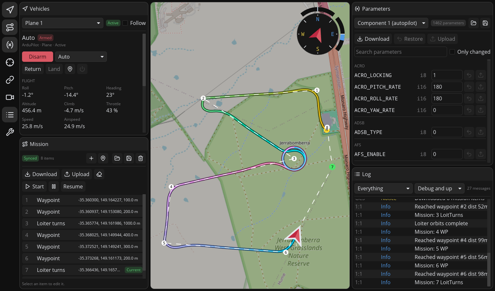

# Groundhog

Groundhog is a light weight and responsive ground control station for vehicles that speak MAVLink, such
as those running ArduPilot or PX4. It is written in Rust with the
[iced](https://github.com/iced-rs/iced) GUI toolkit, and runs on both desktops and (experimentally) on Android.

<p align="center">
  
</p>

## Features

- View telemetry and status messages, or command arming and flight modes
- Plan waypoint missions, upload and download, also with no vehicle connected
- Edit and synchronize parameters, with loading and saving of parameter files
- Sensor calibration routines for ArduPilot and PX4 with live feedback
- Low-latency video reception from the vehicle, with record-to-file built in
- UDP, TCP and serial links, several at once, with automatic routing to the vehicle
- Telemetry is recorded and stored in the `.tlog` format

## Design

- **A workspace you arrange.** Panels open in columns and a row around the
  map, so the mission, parameters, video and log can all be on screen at
  once.
- **One application for desktop and phone.** The same panels are shown in a
  tiled layout for a mouse and a large screen, or in a touch layout with a
  navigation bar and sheets over the map. It picks one by screen size.
- **Careful by default.** Commands that change what a vehicle does ask
  first, parameter writes are refused while the vehicle's parameter encoding
  is unknown, and calibration is refused on a vehicle that may be armed.
- **Redundant links handled properly.** A vehicle heard on several links is
  recognised as one; duplicate packets are dropped, and commands take the
  faster link.
- **A reusable backend.** All vehicle state and MAVLink handling lives in
  the `groundhog-logic` crate, separate from the UI, so another frontend or
  a headless tool can be built on it.
- **Native and lightweight.** A single Rust binary, rendered on the GPU.

## Building

Groundhog builds with a stable Rust toolchain (install it with
[rustup](https://rustup.rs)). It also needs a few system libraries for the
window, serial ports and video (GStreamer, with an H.264 decoder).

On Fedora:

```sh
sudo dnf install pkgconf-pkg-config libxkbcommon-devel wayland-devel systemd-devel \
    gstreamer1-devel gstreamer1-plugins-base-devel gstreamer1-plugins-good \
    gstreamer1-plugins-bad-free gstreamer1-plugin-libav
```

On Debian and Ubuntu:

```sh
sudo apt install pkg-config libxkbcommon-dev libwayland-dev libudev-dev \
    libgstreamer1.0-dev libgstreamer-plugins-base1.0-dev gstreamer1.0-plugins-good \
    gstreamer1.0-plugins-bad gstreamer1.0-libav
```

Then build and run it:

```sh
cargo run --release
```

To try it without a vehicle, run ArduPilot or PX4 SITL and add a UDP link
listening on the port it sends to (usually 14550).

Groundhog can also be built as a [Flatpak](flatpak/README.md) or as an
[Android APK](android/README.md).

## Contributing

[AGENTS.md](AGENTS.md) describes the architecture, the design decisions
behind it, and the conventions the code follows. It is written for people
and coding agents alike.
